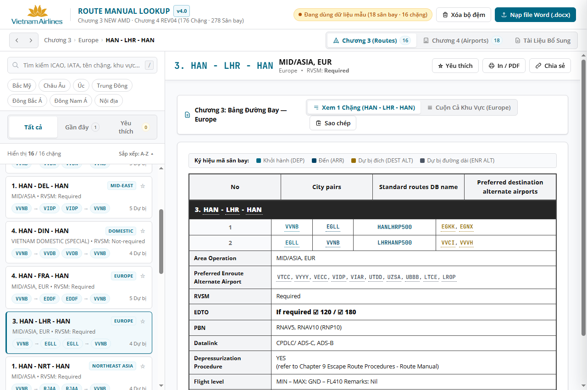

# Vietnam Airlines — Route Manual Interactive Lookup System v4.0

Hệ thống tra cứu tương tác mạng đường bay (**Chương 3**) & đánh giá sân bay (**Chương 4**) của Vietnam Airlines (VNA), chạy hoàn toàn trên trình duyệt (**Client-side Web Application**, không cần backend server) với khả năng phân tích trực tiếp cấu trúc Office Open XML (OOXML) của file Microsoft Word (`.docx`).



---

## 🌟 Tính Năng Nổi Bật (Key Features)

### 1. Phân tích tài liệu lớn trực tiếp trên trình duyệt (Client-side OOXML Engine)
- Tự động giải nén và phân tích trực tiếp cấu trúc XML của:
  - **`CHAPTER 3_NEW_AMD.docx`** (~3.89 MB): Toàn bộ 176 đường bay trên 7 khu vực hoạt động (Bắc Mỹ, Châu Âu, Úc, Trung Đông, Đông Bắc Á, Đông Nam Á, Nội địa).
  - **`CHAPTER 4_REV04.docx`** (~40.22 MB): Đánh giá chi tiết 278 sân bay (Mục 1–10) và hơn 328 sơ đồ kỹ thuật / biểu đồ thoát hiểm núi EOSID.
- Cơ chế **Lazy On-Demand Blob Extraction**: Trích xuất sơ đồ kỹ thuật ra Blob URL chỉ khi người dùng bấm xem, tối ưu hóa bộ nhớ RAM.
- Tự động lưu trữ bộ đệm vào **IndexedDB** an toàn, không gửi bất kỳ dữ liệu nội bộ nào ra bên ngoài.

### 2. Giao diện chuẩn VNA UI Styleguide (Light Theme)
- Áp dụng triệt để bộ nhận diện thương hiệu theo **VNA UI Styleguide — Safety Data Governance**:
  - Tông màu chủ đạo: **Primary Teal** (`#006885`) và **Secondary Gold** (`#DCB033`).
  - Biểu trưng chính thức: **Hoa sen vàng** và chữ **Vietnam Airlines** chuẩn vector sắc nét.
  - Typography: Google Font **Open Sans** (400, 500, 600, 700) cho toàn bộ giao diện; font monospace (`JetBrains Mono`, `Consolas`) cho mã ICAO, IATA và tên đường bay DB.
- **Bảo toàn 100% màu sắc tài liệu Word gốc**:
  - Nền vàng tiêu đề mục: `#FFE599`
  - Nền xanh lá ô phân loại đạt chuẩn: `#70AD47` (`ADQ`)
  - Nền xám tiêu đề phụ đường băng: `#E7E6E6`
  - Thanh tiêu đề chặng bay đen đậm: `#262626` (chữ trắng in đậm)

### 3. Tối ưu hóa trải nghiệm người dùng (UX) v4.0
- **Khắc phục lỗi cuộn**: Khi chọn bất kỳ sân bay nào (kể cả ở cuối danh sách 278 sân bay), khung nội dung tự động cuộn về đỉnh trang (`scrollTop: 0`), đồng thời giữ thẻ đang chọn luôn hiển thị trong danh sách bên trái.
- **Thanh tiêu đề cố định (Sticky Entity Header)**: Hiển thị mã `ICAO / IATA`, phân hạng `CAT`, `RFFS`, `ELEV`, dải trạng thái đội tàu bay (`ATR`, `A320`, `A321`, `A350`, `B787`), cùng các nút: ☆ Yêu thích, In / PDF, Chia sẻ liên kết.
- **Thanh mục lục nhảy nhanh 1–10 (Sticky TOC Bar với Scroll-Spy)**:
  - Các mục: `1. Category`, `2. RFFS`, `3. Classification`, `4. Standards`, `5. Runways`, `6. Obstacles`, `7. EOSID`, `8. IAP`, `9. Company Note`, `10. Remark` và nút nhảy nhanh tới sơ đồ đính kèm.
  - Tự động đánh dấu mục đang đọc bằng `IntersectionObserver`, độ chồng lấn sticky = 0px.
- **Tương tác sân bay thông minh**:
  - **Hover (140ms)**: Hiển thị hộp xem nhanh (Quick-preview Popover) thông tin sân bay, đường băng, phân loại tàu bay.
  - **Click**: Mở bảng đánh giá sân bay Chương 4 qua **Slide-over Drawer** trượt từ mép phải mà không làm mất vị trí đang đọc ở Chương 3.
- **Xem sơ đồ kỹ thuật (Lightbox Modal)**:
  - Hỗ trợ lăn chuột Zoom in/out (50% – 400%), kéo chuột Pan, nút mở ảnh gốc ở Tab mới và tải ảnh về.
- **Lịch sử Gần đây (Recents) & Yêu thích (Favorites)**: Lưu trữ tự động 20 mục tra cứu gần nhất và danh sách đánh dấu sao vào `localStorage`.
- **Bộ lọc nhanh dạng Chip**: Lọc theo khu vực (Chương 3); lọc theo `CAT A/B/C`, `ADQ A350`, `ADQ B787`, hoặc sân bay có sơ đồ đính kèm (Chương 4).
- **In / Xuất PDF chuẩn khổ A4 chuyên dụng**: Tích hợp `print.css`, tự động ẩn thanh điều hướng và in trang tài liệu rõ nét kèm dấu thời gian.
- **Tìm kiếm trực tiếp**: Hỗ trợ tìm mã ICAO, IATA, tên chặng, khu vực, và các từ khóa quy trình như `"depress"`, `"giảm áp"`, `"escape"`, `"chapter 9"`.

---

## 📁 Cấu Trúc Mã Nguồn (Project Structure)

```text
Route_Manual/
├── index.html                        # File điều hướng gốc
├── vna-rm-app/                       # Thư mục ứng dụng chính
│   ├── index.html                    # Giao diện chính (Dual-mode loader)
│   ├── assets/
│   │   ├── brand/
│   │   │   ├── vna-logo.png          # Logo chính thức Vietnam Airlines (trong suốt)
│   │   │   └── vna-logo.svg          # Logo định dạng vector SVG
│   │   ├── styles/
│   │   │   ├── tokens.css            # Design tokens chuẩn VNA Styleguide (#006885, #DCB033)
│   │   │   ├── components.css        # Các component UI cơ sở (nút, input, badge, chip, modal)
│   │   │   ├── layout.css            # Split-pane, Drawer trượt phải, Popover, Topbar
│   │   │   ├── document-tables.css   # Mô phỏng 100% định dạng bảng Word Chương 3 & 4
│   │   │   └── print.css             # Định dạng in ấn khổ A4 (@media print)
│   │   └── vna-rm-bundle.js          # Gói standalone phục vụ chạy offline qua file://
│   └── src/                          # Mã nguồn module ES6 sạch phục vụ tích hợp DMS
│       ├── main.js                   # Khởi tạo và điều phối luồng ứng dụng
│       ├── db/
│       │   ├── idbStore.js           # Quản lý IndexedDB & trích xuất ảnh Blob on-demand
│       │   └── seedData.js           # Dữ liệu mẫu khởi động (16 chặng bay & 18 sân bay hạt nhân)
│       ├── parsers/
│       │   ├── ooxmlUtils.js         # Tiện ích đọc XML an toàn (lọc w:del, checkbox ☑/☐, màu w:shd)
│       │   ├── chapter3Parser.js     # Parser Chương 3 (7 khu vực, 176 đường bay, Depressurization)
│       │   └── chapter4Parser.js     # Parser Chương 4 (278 sân bay, 328 ảnh sơ đồ, phụ lục)
│       ├── components/
│       │   ├── Chapter3TableView.js  # Bảng Chương 3 chuẩn Word (xem lẻ & cuộn cả khu vực)
│       │   ├── Chapter4TableView.js  # Bảng Chương 4 chuẩn Word (Mục 1-10, nút hyperlink ảnh)
│       │   ├── AirportHoverCard.js   # Popover xem nhanh khi rê chuột (Hover)
│       │   ├── AirportSlideDrawer.js # Drawer trượt từ mép phải khi click mã sân bay
│       │   ├── ImageLightboxModal.js # Lightbox xem ảnh (Zoom, Pan, mở Tab mới qua Blob)
│       │   └── SidebarNav.js         # Thanh tìm kiếm, lọc chip, phân tab Tất cả / Gần đây / Yêu thích
│       └── utils/
│           ├── airportLinker.js      # Tự động gắn liên kết tương tác cho mã sân bay ICAO/IATA
│           ├── router.js             # Định tuyến URL Hash (#/route/..., #/airport/...) & Lịch sử
│           └── userPrefs.js          # Quản lý Gần đây (Recents) & Yêu thích (Favorites)
├── tools/
│   └── build-bundle.mjs              # Công cụ tự động biên dịch src/ thành vna-rm-bundle.js
├── test_full_parsers.py              # Kiểm tra cấu trúc OOXML trên 2 file Word thực tế
├── test_v4_deep_verification.mjs     # Kiểm thử tự động chuyên sâu giao diện v4.0 qua Chrome CDP
└── README.md                         # Tài liệu hướng dẫn dự án
```

---

## 🚀 Hướng Dẫn Sử Dụng (Quick Start)

### Chế độ 1: Chạy trực tiếp ngoại tuyến (Offline / File Protocol)
1. Clone hoặc tải mã nguồn về máy:
   ```bash
   git clone https://github.com/TinhBK257/Route_Manual.git
   ```
2. Mở trực tiếp file **`index.html`** hoặc **`vna-rm-app/index.html`** bằng trình duyệt **Google Chrome** hoặc **Microsoft Edge**.
3. Ứng dụng khởi động ngay lập tức với dữ liệu mẫu có sẵn (16 chặng bay & 18 sân bay).

### Chế độ 2: Nạp dữ liệu chính thức từ file Word (.docx)
1. Nhấn nút **"Nạp file Word (.docx)"** trên thanh tiêu đề.
2. Chọn hoặc kéo thả 2 file:
   - `CHAPTER 3_NEW_AMD.docx` (~3.89 MB)
   - `CHAPTER 4_REV04.docx` (~40.22 MB)
3. Nhấn **"Bắt Đầu Phân Tích"**. Hệ thống sẽ trích xuất toàn bộ 176 đường bay và 278 sân bay lưu vào **IndexedDB**. Dữ liệu sẽ được lưu trữ cục bộ cho các lần sử dụng tiếp theo.

### Chế độ 3: Triển khai trên máy chủ Web nội bộ (DMS Server)
- Đưa thư mục dự án lên bất kỳ máy chủ HTTP/HTTPS nào (Nginx, Apache, IIS, NodeJS, hoặc Caddy).
- Khi chạy qua giao thức HTTP/HTTPS, ứng dụng tự động nạp kiến trúc **ES Modules** hiện đại từ thư mục `src/`.

---

## 🧪 Kiểm Thử Tự Động (Automated Testing)

Chạy bộ kiểm thử tự động để xác minh tính toàn vẹn của dữ liệu và giao diện:

```bash
# Kiểm tra bộ parser OOXML trên 2 file Word gốc
python test_full_parsers.py

# Kiểm thử giao diện chuyên sâu v4.0 bằng Headless Chrome (Chrome DevTools Protocol)
node test_v4_deep_verification.mjs
```

---

## 📄 Bản Quyền & Tiêu Chuẩn

- Phát triển cho hệ thống tài liệu khai thác bay / DMS của **Vietnam Airlines**.
- Tuân thủ tiêu chuẩn tài liệu hàng không quốc tế (ICAO / IATA / FAA) và tiêu chuẩn thiết kế **VNA UI Styleguide**.
